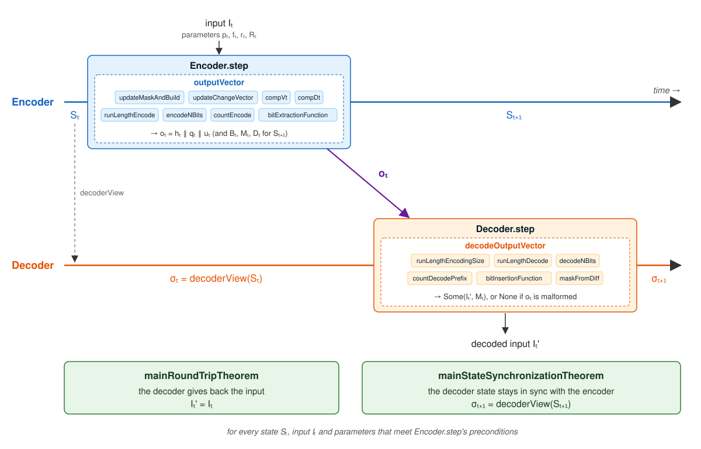

# Verification Overview

This document gives a short tour of the Stainless-verified functional specification of the
POCKET+ codec (CCSDS 124.0-B-1), in
[`PocketExecSpec.scala`](../pocketplus/scala/src/main/scala/pocket/PocketExecSpec.scala). The
encoder and decoder are written on `List[Boolean]` bit vectors. The main theorems prove that
decoding gives back every input vector and that the decoder stays in sync with the encoder.

## One encode/decode step and the main theorems

## Pointers to the code

All links point into `PocketExecSpec.scala`.

**States**

- [`CompressionState`](../pocketplus/scala/src/main/scala/pocket/PocketExecSpec.scala#L47) is the
  encoder state Sₜ: t, F, M₀, Iₜ₋₁, Bₜ₋₁, Mₜ₋₁ and the history of the last D's and p's.
- [`DecompressionState`](../pocketplus/scala/src/main/scala/pocket/PocketExecSpec.scala#L74) is the
  decoder state σₜ: t, F, Iₜ₋₁, Mₜ₋₁.
- [`decoderView`](../pocketplus/scala/src/main/scala/pocket/PocketExecSpec.scala#L97) is the function that projects the encoder state Sₜ to the decoder state σₜ.

**Entry points**

- Encoder: [`Encoder.step`](../pocketplus/scala/src/main/scala/pocket/PocketExecSpec.scala#L170)
  - [`Encoder.outputVector`](../pocketplus/scala/src/main/scala/pocket/PocketExecSpec.scala#L216)
    builds oₜ = hₜ ‖ qₜ ‖ uₜ and follows the blue book (sections 4 and 5.3) closely.
- Decoder: [`Decoder.step`](../pocketplus/scala/src/main/scala/pocket/PocketExecSpec.scala#L306)
  - [`Decoder.decodeOutputVector`](../pocketplus/scala/src/main/scala/pocket/PocketExecSpec.scala#L329)
    mirrors `outputVector`: it reads oₜ field by field and returns `None` on a malformed packet.

**Main theorems** (in `object EncodeDecodeRoundTripProof`)

- [`mainRoundTripTheorem`](../pocketplus/scala/src/main/scala/pocket/PocketExecSpec.scala#L944):
  decoding an encoded vector gives back the original vector, for every state, input and parameters.
- [`mainStateSynchronizationTheorem`](../pocketplus/scala/src/main/scala/pocket/PocketExecSpec.scala#L970):
  after one step, the decoder state equals `decoderView` of the next encoder state.

Both are proved through
[`lemmaDecodeOutputVector`](../pocketplus/scala/src/main/scala/pocket/PocketExecSpec.scala#L859),
which relies on these lemmas:

- [`lemmaMaskFromHt`](../pocketplus/scala/src/main/scala/pocket/PocketExecSpec.scala#L812):
  Mₜ can be recovered from hₜ.
- [`lemmaInputChangesInsideMask`](../pocketplus/scala/src/main/scala/pocket/PocketExecSpec.scala#L846):
  the bits outside the mask are unchanged since Iₜ₋₁.
- [`lemmaDecodeFields`](../pocketplus/scala/src/main/scala/pocket/PocketExecSpec.scala#L707):
  each field of the packet is decoded in turn.

**Invertibility of the sub-functions**

| Encoder side | Decoder side | Round-trip lemma |
|---|---|---|
| `runLengthEncode` (RLE) | `runLengthEncodingSize` + `runLengthDecode` | [`lemmarunLengthEncodeRoundTrip`](../pocketplus/scala/src/main/scala/pocket/PocketExecSpec.scala#L1420), [`lemmaRunLengthEncodingSizeCorrectWithSuffix`](../pocketplus/scala/src/main/scala/pocket/PocketExecSpec.scala#L1467) |
| `encodeNBits(·, 4, ·)` (BIT₄) | `decodeNBits` | [`lemmaEncodeNBitsDecodeNBitsRoundTrip`](../pocketplus/scala/src/main/scala/pocket/PocketExecSpec.scala#L1605) |
| `countEncode` (COUNT) | `countDecodePrefix` | [`lemmaCountEncodeDecodeRoundTripWithSuffix`](../pocketplus/scala/src/main/scala/pocket/PocketExecSpec.scala#L1547) |
| `bitExtractionFunction` (BE) | `bitInsertionFunction` (BI) | [`lemmaBitInsertionExtraction`](../pocketplus/scala/src/main/scala/pocket/PocketExecSpec.scala#L1530) |
| `xor(m, leftShift(m))` | `maskFromDiff` | [`lemmaMaskFromDiff`](../pocketplus/scala/src/main/scala/pocket/PocketExecSpec.scala#L592) |

## Running the verification and the tests

From `pocketplus/scala/`:

- `./verify.sh` runs Stainless on the spec and the other Scala sources (settings in `stainless.conf`).
- `sbt "runMain pocket.test.RoundTripTest"` round-trips randomized packet sequences through
  `Encoder.step` and `Decoder.step`, and checks that malformed packets are rejected.
- `sbt "runMain pocket.test.SpecTest"` checks the encoder against hand-written cases and the
  differential test vectors.

See [`pocketplus/scala/README.md`](../pocketplus/scala/README.md) for the setup and the other tests.
