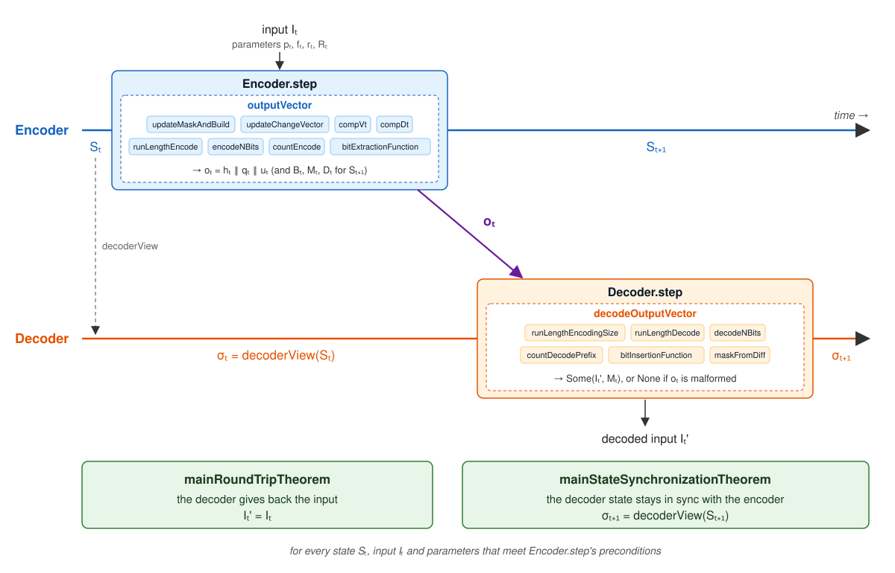

# PocketPlus (Scala / Stainless)

## Setup

Run `../install.sh <platform>` from the repo root once to install Stainless and the
`sbt-stainless` plugin into this project (see `project/plugins.sbt`).

## Running the tests

There is no `sbt test` suite here — tests are plain `main` methods that print
`PASS`/`FAIL` per case and exit non-zero on failure. Run them with `sbt runMain`
from the `scala/` directory:

```bash
sbt "runMain pocket.test.SpecTest"
```

Checks `Encoder` (in `PocketExecSpec.scala`) against hand-written cases and the
differential test vectors in `src/test/res/test-vectors/differential/cases.json`.

```bash
sbt "runMain pocket.test.CrossCheckTest"
```

Cross-checks the Stainless-verified `List[Boolean]` encoder (`PocketExecSpec`) against
the array-based `Decompressor` in `PocketPlus.scala`, over randomized packet sequences
at several values of `F`.

```bash
sbt "runMain pocket.test.RoundTripTest"
```

Round-trips randomized packet sequences (fixed seed, 50 runs of 120 steps) through
`Encoder.step` and `Decoder.step` (in `PocketExecSpec.scala`), with random `R_t`, `p_t`,
`f_t`, `r_t`. It checks that every input vector is recovered and that the decoder state
stays in sync with the encoder (`decoderView`). It also checks that malformed packets are rejected.

```bash
sbt "runMain pocket.Main"
```

Runnable demo that compresses a couple of hand-picked input vectors and prints every
intermediate bit vector, for eyeballing the packet layout against the blue book
(section 5.3.3).

## Stainless verification

```bash
./verify.sh
```

Runs `stainless-dotty` on `PocketExecSpec.scala` to verify the contracts/preconditions
in the spec (uses `stainless.conf`). Pass extra Stainless flags as `$1`, e.g.
`./verify.sh --watch`.

### Main interest points

- main encoder implementation: PocketExecSpec.scala:170
  - which uses the `outputVector` function which follows the blue book closely: PocketExecSpec.scala:216

- main decoder implementation: PocketExecSpec.scala:306
  - which uses the `decodeOutputVector` function which mirrors the `outputVector` function: PocketExecSpec.scala:329

- main invertibility theorems:
  - `mainRoundTripTheorem`: PocketExecSpec.scala:944
    - proves that the decoding an encoded vector returns the original vector, for all possible inputs and states
  - `mainStateSynchronizationTheorem`: PocketExecSpec.scala:970
    - proves that the decoder state stays in sync with the encoder state, for all possible inputs and states, after encoding and decoding a vector

- invertibility of sub-functions:
  - `lemmarunLengthEncodeRoundTrip`: PocketExecSpec.scala:1420

### Overview: one encode/decode step and the main theorems



The two theorems cover a single step, and the conclusion of the second is the hypothesis of
both at the next step. Applying them step after step therefore covers a whole stream, provided
the decoder starts from `decoderView(S₀)`.

Each encoding sub-function has an inverse and a round-trip lemma, and the decoder relies on them:

| Encoder side (`BasicEncodingFunctions` / `Utils`) | Decoder side | Round-trip lemma |
|---|---|---|
| `runLengthEncode` (RLE) | `runLengthEncodingSize` + `runLengthDecode` | `lemmarunLengthEncodeRoundTrip`, `lemmaRunLengthEncodingSizeCorrectWithSuffix` |
| `encodeNBits(·, 4, ·)` (BIT₄) | `decodeNBits` | `lemmaEncodeNBitsDecodeNBitsRoundTrip` |
| `countEncode` (COUNT) | `countDecodePrefix` | `lemmaCountEncodeDecodeRoundTripWithSuffix` |
| `bitExtractionFunction` (BE) | `bitInsertionFunction` (BI) | `lemmaBitInsertionExtraction` |
| `xor(m, leftShift(m))` | `maskFromDiff` | `lemmaMaskFromDiff` |
